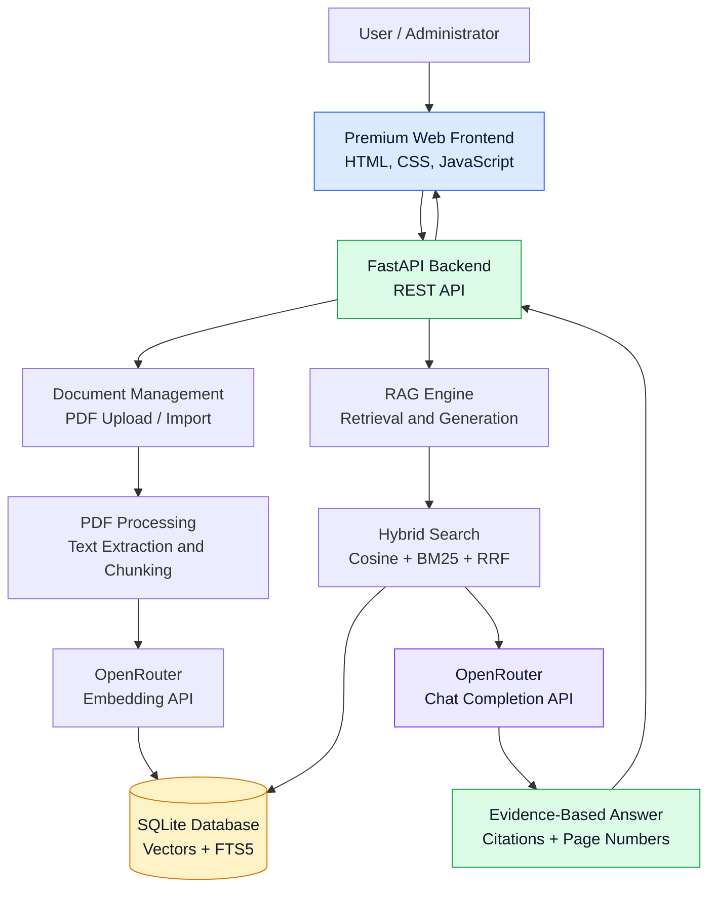
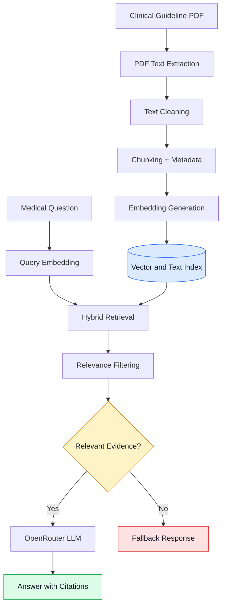
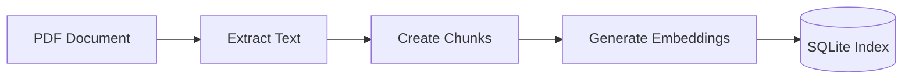
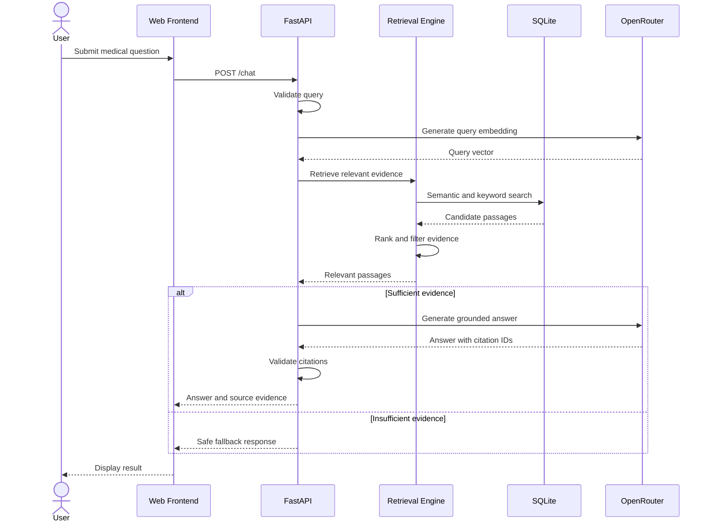
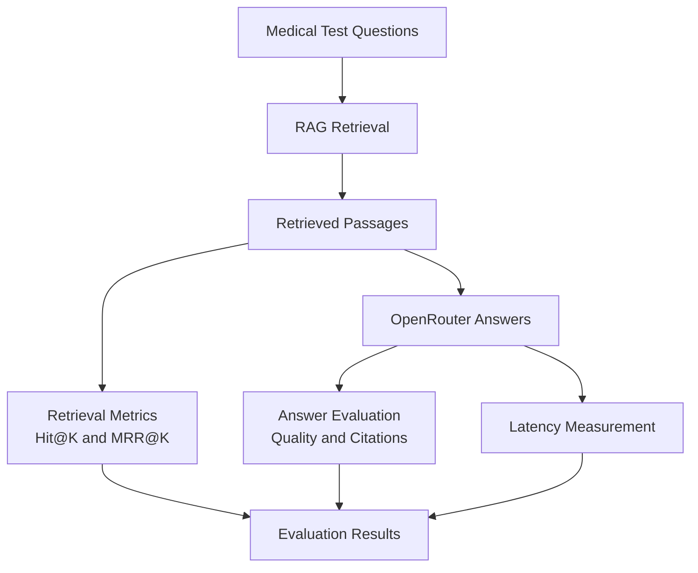

# 🏥 Veritas Health  Medical RAG Chatbot

### Advanced Clinical Guideline Intelligence Powered by OpenRouter

**An AI-powered medical question-answering system using Retrieval-Augmented Generation (RAG), clinical guideline documents, semantic search, and evidence-based response generation.**

Veritas Health is a medical RAG application built with **Python, FastAPI, OpenRouter, and a modern SaaS-style web interface**. It retrieves relevant information from clinical guidelines and generates answers supported by document citations, PDF page numbers, and section references.

The system is designed to reduce unsupported answers by grounding responses in retrieved clinical evidence.

> **Medical Disclaimer:** This project is intended for educational purposes, clinical guideline research, and AI experimentation. It is not a clinically validated medical device and should not be used for independent diagnosis, treatment, or prescribing decisions. Always consult a qualified healthcare professional.


##  Table of Contents

1. [Project Overview](#-project-overview)
2. [Key Features](#-key-features)
3. [Technology Stack](#-technology-stack)
4. [System Architecture](#-system-architecture)
5. [RAG Pipeline](#-rag-pipeline)
6. [Document Processing Workflow](#-document-processing-workflow)
7. [Medical Question Answering Workflow](#-medical-question-answering-workflow)
8. [Project Structure](#-project-structure)
9. [Installation and Setup](#-installation-and-setup)
10. [OpenRouter Configuration](#-openrouter-configuration)
11. [Knowledge Base Management](#-knowledge-base-management)
12. [Example Questions](#-example-questions)
13. [API Endpoints](#-api-endpoints)
14. [Evaluation and Testing](#-evaluation-and-testing)
15. [Results](#-results)
16. [Security and Privacy](#-security-and-privacy)
17. [Limitations](#-limitations)
18. [Future Improvements](#-future-improvements)
19. [Troubleshooting](#-troubleshooting)
20. [Conclusion](#-conclusion)


##  Project Overview

Medical information must be accurate, reliable, and supported by trustworthy sources. Traditional Large Language Models (LLMs) can generate convincing answers even when the information is incorrect or outdated.

To address this challenge, I developed **Veritas Health**, a Retrieval-Augmented Generation chatbot that answers medical questions using indexed clinical guideline documents.

Instead of relying entirely on the LLM's general knowledge, the system retrieves relevant passages from its knowledge base and uses those passages to generate evidence-based responses.

### Project Objectives

The main objectives of this project are:

- Develop an advanced medical RAG chatbot.
- Extract and process information from clinical guideline PDFs.
- Implement text chunking and embedding generation.
- Perform semantic similarity search.
- Combine vector retrieval with keyword-based search.
- Generate medical answers using OpenRouter.
- Provide source citations with PDF page numbers.
- Avoid unsupported answers through relevance thresholds.
- Handle empty, invalid, and out-of-scope questions.
- Build a professional and user-friendly web interface.
- Evaluate retrieval accuracy, answer quality, and response time.

The application also includes knowledge-base management, administrator controls, and an evaluation workflow.


##  Key Features

### 1. Medical RAG Chatbot

An AI-powered chatbot that generates answers using relevant clinical guideline passages.

- Evidence-based question answering
- Context-aware response generation
- OpenRouter LLM integration
- English and Urdu question support
- Source-aware answers
- Conversation interface
- Suggested medical questions

### 2. Clinical Document Processing

The system processes medical guideline documents in PDF format.

- PDF upload and processing
- Page-by-page text extraction
- Text chunking with overlap
- Section metadata extraction
- Document source tracking
- Persistent knowledge-base indexing

### 3. Semantic Search and Retrieval

Relevant clinical information is retrieved using semantic similarity and lexical matching.

- OpenRouter embedding generation
- Cosine similarity search
- SQLite vector storage
- SQLite FTS5 keyword search
- BM25-based lexical ranking
- Reciprocal Rank Fusion (RRF)
- Top-K passage retrieval
- Relevance threshold filtering

### 4. Transparent Source Citations

Generated answers include references to their supporting evidence.

- Clinical guideline title
- PDF page number
- Section reference when available
- Supporting source passages
- Citation identifiers
- Original PDF viewing

Citation metadata is taken from indexed documents rather than invented by the language model.

### 5. Intelligent Fallback Handling

When relevant evidence is unavailable, the system returns a fallback response.

Example:

> I could not find sufficiently relevant evidence in the uploaded clinical guidelines. Please consult a qualified healthcare professional or upload a relevant, current guideline.

This helps prevent unsupported medical recommendations.

### 6. Premium SaaS-Style Frontend

The application includes a responsive web interface designed for a smooth user experience.

**Main interface features:**

- Medical AI assistant
- Clinical guideline library
- Document search and browsing
- Evidence citation cards
- Original PDF viewer
- Administrator access
- Evaluation dashboard
- System health indicators
- Conversation export
- Helpful / Not Helpful feedback
- Responsive layout

### 7. Administrator Controls

Administrators can manage the clinical knowledge base.

- Upload guideline PDFs
- Import authorized publisher documents
- Delete indexed documents
- Run evaluations
- Access feedback statistics
- Manage document indexing

Administrative operations are protected using an administrator API key.


##  Technology Stack

| Component | Technology |
|---|---|
| Programming Language | Python |
| Backend Framework | FastAPI |
| ASGI Server | Uvicorn |
| AI Model Gateway | OpenRouter |
| Chat Model | GPT-4o Mini via OpenRouter |
| Embedding Model | text-embedding-3-small via OpenRouter |
| Document Processing | PyMuPDF |
| Vector Similarity | Cosine Similarity |
| Lexical Retrieval | SQLite FTS5 / BM25 |
| Hybrid Ranking | Reciprocal Rank Fusion |
| Database | SQLite |
| Frontend | HTML, CSS, JavaScript |
| API Communication | REST / JSON |
| Testing | Pytest |
| API Documentation | Swagger UI |
| Operating System | Windows / Linux |

The chat and embedding models can be changed through the application's configuration, provided the selected models are supported by OpenRouter.


## System Architecture

The application follows a modular architecture consisting of the frontend, FastAPI backend, document processing pipeline, retrieval engine, and OpenRouter LLM integration.

### High-Level Architecture Diagram



### Architecture Explanation

The user interacts with the web frontend, which communicates with the FastAPI backend.

The backend handles document management, retrieval requests, embedding generation, and LLM communication.

Medical documents are processed and indexed into SQLite. When a question is submitted, the retrieval engine identifies relevant passages and passes them to OpenRouter for grounded answer generation.

The final response is displayed with citations and source metadata.


##  RAG Pipeline

Retrieval-Augmented Generation combines information retrieval with language model generation.

The system consists of two major processes:

1. **Document Ingestion:** Preparing and indexing clinical guideline documents.
2. **Query Processing:** Retrieving relevant passages and generating an answer.

### Complete RAG Workflow




##  Document Processing Workflow

The knowledge base stores clinical guideline documents that are used to support the chatbot's answers.

### Step 1  PDF Upload

An administrator uploads an authorized PDF or imports a document from the official publisher catalogue.

The application validates and processes the document before indexing.

### Step 2  Text Extraction

PyMuPDF extracts text from the PDF page by page.

Each extracted passage is associated with information such as:

- Document title
- Source URL
- PDF page number
- Section heading when detectable
- Text content

### Step 3  Text Chunking

Large documents are split into smaller passages.

Chunking helps the retrieval system locate specific information without searching or sending the complete document to the LLM.

Overlapping chunks help preserve context between adjacent passages.

### Step 4  Embedding Generation

Each text chunk is converted into a numerical embedding using OpenRouter.

Embeddings represent text in vector form, allowing the system to compare semantic meaning.

### Step 5 Database Storage

The system stores searchable embeddings and document metadata in SQLite.

A separate SQLite FTS5 index supports keyword-based retrieval.

### Document Indexing Diagram




##  Medical Question Answering Workflow

When a user asks a medical question, the system performs the following steps.

### Step 1  Query Validation

The system checks whether the user has entered a meaningful question.

Empty or invalid queries are handled before invoking the retrieval pipeline.

### Step 2 Query Embedding

The question is converted into an embedding using the same embedding model used for indexed documents.

### Step 3  Similarity Search

The query embedding is compared with stored chunk embeddings using cosine similarity.

The application also performs keyword retrieval using SQLite FTS5.

### Step 4 Hybrid Retrieval

Semantic and lexical search results are combined through Reciprocal Rank Fusion.

This improves the ability to retrieve relevant passages when wording differs between the question and the guideline.

### Step 5 Relevance Filtering

The system applies relevance checks to determine whether there is enough evidence to answer.

If the evidence is insufficient, the chatbot returns a fallback response.

### Step 6  OpenRouter Answer Generation

Relevant passages are sent to the selected OpenRouter chat model with a grounding prompt.

The model is instructed to answer using the supplied evidence rather than unsupported assumptions.

### Step 7  Citation Verification

The generated answer is checked against available citation identifiers.

Source references are associated with indexed document metadata.

### Step 8  Final Response

The frontend displays:

- Generated answer
- Supporting evidence
- Source document
- PDF page numbers
- Section references
- Links to the source PDF

### Question Processing Diagram




##  Project Structure

The following shows the key project directories and components.

```text
Medical-RAG-Chatbot-OpenRouter/
│
├── app/
│   ├── api.py
│   └── ...
│
├── ui/
│   ├── web/
│   │   ├── index.html
│   │   └── assets/
│   │       ├── styles.css
│   │       └── app.js
│   │
│   └── streamlit_app.py
│
├── data/
│   ├── guidelines/
│   └── eval_nice.json
│
├── scripts/
│   ├── bootstrap_guidelines.py
│   └── evaluate.py
│
├── tests/
│
├── requirements.txt
├── requirements-streamlit.txt
├── .env.example
├── start_windows.bat
└── README.md
```

The `app/` directory contains the backend and RAG implementation.

The `ui/` directory contains the web interface and optional Streamlit frontend.

The `data/` directory is used for guideline storage and evaluation resources.

The `scripts/` directory contains command-line utilities for importing guidelines and evaluating the system.

The `tests/` directory contains automated tests.


##  Installation and Setup

### Prerequisites

Before running the project, make sure the following are available:

- Python 3.11
- Git
- Internet connection
- OpenRouter account
- OpenRouter API key
- VS Code or another code editor

### Step 1 — Clone the Repository

```bash
git clone https://github.com/behra527/Medical-RAG-Chatbot-OpenRouter.git
```

Open the project directory:

```bash
cd Medical-RAG-Chatbot-OpenRouter
```

### Step 2 — Create Virtual Environment

For Windows PowerShell:

```powershell
py -3.11 -m venv .venv
```

Activate the environment:

```powershell
.\.venv\Scripts\Activate.ps1
```

### Step 3 — Install Dependencies

```powershell
python -m pip install --upgrade pip
python -m pip install -r requirements.txt
```

### Step 4 — Configure Environment Variables

Create the environment file:

```powershell
Copy-Item .env.example .env
```

Open it:

```powershell
notepad .env
```

Add the required values:

```dotenv
OPENROUTER_API_KEY=your_actual_openrouter_api_key
ADMIN_API_KEY=your_secure_random_admin_key
```

Keep the remaining settings from `.env.example` unless you need to customize them.

### Step 5 — Generate a Secure Admin Key

You can generate a random administrator key using:

```powershell
python -c "import secrets; print(secrets.token_urlsafe(32))"
```

Copy the generated value into `ADMIN_API_KEY`.

Do not share this key publicly.

### Step 6 — Start the Application

```powershell
python -m uvicorn app.api:app --reload --host 127.0.0.1 --port 8000
```

### Step 7 — Open the Frontend

**Application:**

http://127.0.0.1:8000/

**API Documentation:**

http://127.0.0.1:8000/docs

**Health Check:**

http://127.0.0.1:8000/health

The premium frontend is served directly through FastAPI.

No separate Node.js frontend server is required.

### Optional Streamlit Frontend

The older Streamlit interface can be run separately if needed.

Install the optional dependencies:

```powershell
python -m pip install -r requirements-streamlit.txt
```

Run:

```powershell
streamlit run ui/streamlit_app.py
```

The premium application does not require Streamlit.


##  OpenRouter Configuration

The system uses OpenRouter for embedding generation and LLM response generation.

### Supported Functions

**Embedding API**

Transforms clinical guideline passages and user questions into embeddings for semantic search.

**Chat Completions API**

Generates natural-language answers using retrieved guideline passages.

### Default Models

| Purpose | Model |
|---|---|
| Embedding Generation | openai/text-embedding-3-small |
| Answer Generation | openai/gpt-4o-mini |

The models can be configured through the application's environment settings.

### API Key Security

Never:

- Commit `.env` to GitHub.
- Hardcode API keys in JavaScript.
- Share API keys in screenshots.
- Expose secret credentials to users.

OpenRouter calls can incur charges depending on the selected models and usage.


##  Knowledge Base Management

The application uses real clinical guideline documents rather than a fabricated or hardcoded knowledge base.

### Indexed Clinical Guideline

The following guideline was indexed during development:

| Field | Value |
|---|---|
| Publisher | National Institute for Health and Care Excellence |
| Document | NG136 — Hypertension in adults |
| Guideline Year | 2026 |
| PDF Pages | 57 |
| Searchable Passages | 108 |
| Medical Domain | Hypertension |

These counts reflect the observed development knowledge base and may differ after re-indexing or changing chunk settings.

### How to Import Documents

1. Open the application.
2. Navigate to **Knowledge Library**.
3. Enter the administrator API key.
4. Select an authorized clinical guideline.
5. Review the document licence.
6. Import or upload the document.
7. Wait for successful indexing.
8. Verify the number of documents and passages.

Once the guideline is indexed, the chatbot can retrieve its relevant passages.

### Available Publisher Catalogue

The prototype includes references to:

**World Health Organization**

Guideline for the pharmacological treatment of hypertension in adults (2021).

https://www.who.int/publications/i/item/9789240033986

**National Institute for Health and Care Excellence**

NG136 — Hypertension in adults: diagnosis and management.

https://www.nice.org.uk/guidance/ng136

### Document Licensing

The WHO guideline is published under a non-commercial licence, while NICE content is subject to publisher reuse conditions that may restrict use outside the United Kingdom or in commercial products.

Before importing or distributing clinical content, verify that your intended use is permitted.

Do not assume publicly downloadable PDFs can be freely redistributed in a commercial SaaS application.


##  Example Questions

After indexing an appropriate hypertension guideline, try these questions.

### Basic Questions

1. What is hypertension?
2. How is hypertension diagnosed in adults?
3. What is considered high blood pressure?
4. What lifestyle changes help reduce blood pressure?
5. What is ambulatory blood pressure monitoring?

### Intermediate Questions

6. What is the difference between stage 1 and stage 2 hypertension?
7. How does NICE recommend confirming hypertension?
8. What blood pressure targets are recommended for adults under 80?
9. When should antihypertensive treatment be started?
10. What investigations are recommended for newly diagnosed hypertension?

### Advanced Questions

11. What is the recommended first-line treatment for hypertension?
12. How should resistant hypertension be managed?
13. How does NICE recommend managing severe hypertension?
14. What is the treatment approach for patients with type 2 diabetes?
15. What are the blood pressure targets for adults aged 80 and older?

### Citation Testing

**Question:**

How does NICE recommend confirming hypertension when clinic blood pressure is between 140/90 and 180/120 mmHg? Provide source citations, page numbers, and guideline section references.

### Unsupported Question Testing

**Question:**

What chemotherapy treatment is recommended for stage 4 lung cancer?

If the knowledge base contains only hypertension guidelines, the chatbot should abstain because the required clinical evidence is unavailable.


##  API Endpoints

FastAPI provides REST endpoints for the frontend and external integrations.

| Method | Endpoint | Description |
|---|---|---|
| GET | `/` | Premium frontend |
| GET | `/health` | Application health |
| GET | `/documents` | List indexed documents |
| GET | `/documents/{id}/pdf` | Open indexed PDF |
| GET | `/api/catalog` | Official publisher catalogue |
| POST | `/api/catalog/import` | Import authorized guideline |
| POST | `/documents/upload` | Upload clinical PDF |
| DELETE | `/documents/{id}` | Delete document |
| POST | `/chat` | Generate RAG response |
| POST | `/retrieve` | Retrieve relevant passages |
| GET | `/api/system` | System information |
| POST | `/api/feedback` | Submit response feedback |
| POST | `/evaluation/run` | Run evaluation |

Some endpoints require the administrator API key.

### API Documentation

Open Swagger UI:

```text
http://127.0.0.1:8000/docs
```

### Example Retrieval Request

```powershell
$body = @{
    question = "How is hypertension diagnosed?"
} | ConvertTo-Json

Invoke-RestMethod `
    -Uri "http://127.0.0.1:8000/retrieve" `
    -Method Post `
    -ContentType "application/json" `
    -Body $body
```

The retrieval API returns evidence according to the available indexed documents and configured relevance filters.

---

##  Evaluation and Testing

The project includes an evaluation workflow to measure retrieval performance and answer quality.

### Evaluation Objectives

The evaluation covers:

1. Retrieval accuracy
2. Answer quality
3. Citation correctness
4. Response time
5. Fallback behavior
6. Invalid input handling

### Evaluation Metrics

| Metric | Purpose |
|---|---|
| Hit@K | Checks whether relevant evidence appears in the top-K results |
| MRR@K | Measures how highly the first relevant result is ranked |
| Answer Keyword Coverage | Estimates coverage of expected answer concepts |
| Citation Presence | Checks whether answers include source citations |
| Abstention Rate | Measures fallback behavior |
| Response Latency | Measures how long responses take |
| LLM-as-Judge | Optional automated answer-quality estimate |

Automated answer-quality scores are proxies. They do not replace expert clinical review.

### Retrieval Evaluation

Retrieval performance can be measured using a labeled question set.

For each question, the system retrieves the most relevant passages and compares them against expected evidence.

### Answer Evaluation

The generated answer can be assessed for:

- Relevance
- Factual consistency with retrieved text
- Completeness
- Citation support
- Unsupported claims
- Clarity

### Run Automated Tests

```powershell
python -m pytest -q
```

### Evaluate Retrieval

```powershell
python scripts/evaluate.py --retrieval-only
```

### Evaluate the Full RAG Pipeline

```powershell
python scripts/evaluate.py
```

### Optional LLM-as-Judge Evaluation

```powershell
python scripts/evaluate.py --judge
```

### Evaluation Workflow Diagram




##  Results

### Development Results

During development, the system successfully indexed a real NICE hypertension guideline.

| Metric | Result |
|---|---|
| Indexed Guidelines | 1 |
| Indexed PDF Pages | 57 |
| Searchable Passages | 108 |
| Automated Tests | 18 / 18 passed |
| Backend API | Implemented |
| Premium Frontend | Implemented |
| Evidence Citation Support | Implemented |
| Fallback Handling | Implemented |

### Evaluation Status

| Evaluation Metric | Status |
|---|---|
| Automated Pipeline Tests | Passed |
| Retrieval Hit@K | Live evaluation required |
| MRR@K | Live evaluation required |
| Answer Quality | Clinical review required |
| Average Response Time | Live measurement required |
| Citation Accuracy | Manual verification required |

The 18 passing tests validate implementation behavior using deterministic test scenarios. They do not prove medical accuracy.

Real retrieval accuracy and response-time values should be reported only after running the evaluation against indexed clinical documents with live model access.


##  Future Improvements

The following improvements are planned for future versions.

### Advanced Retrieval

- Dedicated vector database integration
- Semantic reranking
- Query expansion
- Query rewriting
- Metadata-aware filtering
- Improved multilingual retrieval
- Better handling of medical terminology

### Clinical Intelligence

- Clinical expert review workflow
- Guideline version tracking
- Source freshness monitoring
- Automated guideline update detection
- Medical terminology normalization
- Better citation-to-claim verification

### SaaS Platform

- User registration and login
- Role-based access control
- Organization workspaces
- Multi-tenant document isolation
- Usage analytics
- Subscription management
- Audit history
- Administrator dashboard

### Infrastructure

- Docker containerization
- PostgreSQL integration
- Background document indexing
- Task queues
- CI/CD pipelines
- Application monitoring
- Cloud deployment
- API rate limiting

These are planned improvements, not features currently claimed as implemented.


##  Troubleshooting

### Problem 1 — `Not Found` at `/`

Make sure the premium FastAPI application is running:

```powershell
python -m uvicorn app.api:app --reload
```

Open:

```text
http://127.0.0.1:8000/
```

If another application is already using port 8000, launch this project on a different port:

```powershell
python -m uvicorn app.api:app --reload --port 8001
```

### Problem 2 PyMuPDF Installation Error

Use the standard Python 3.11 build.

Check installed versions:

```powershell
py -0p
```

Create a Python 3.11 environment:

```powershell
py -3.11 -m venv .venv
```

Activate it and reinstall the dependencies.

### Problem 3 — Chatbot Cannot Find Relevant Evidence

Check the knowledge base.

If both the document and passage counts are zero, the application has no indexed evidence.

Open **Knowledge Library** and import an authorized clinical guideline.

### Problem 4 — Invalid Administrator API Key

Check the `.env` file:

```dotenv
ADMIN_API_KEY=your_admin_secret
```

Restart the backend if the configuration was changed.

Enter the same key in the Administrator Access section of the web interface.

### Problem 5 — OpenRouter Error

Verify that:

- The API key is valid.
- The selected models are available.
- Internet access is working.
- The account has sufficient credits.
- The configured model names are correct.

### Problem 6 — Unsupported Medical Questions

The system intentionally returns a fallback response when relevant evidence is unavailable.

Index the appropriate clinical guideline or ask a question related to the existing knowledge base.

Do not disable evidence checks merely to force the chatbot to answer.


##  What I Learned

This project helped me understand how Retrieval-Augmented Generation can be used to build more transparent AI applications.

I gained practical experience with:

- Clinical document processing
- Embedding generation
- Vector similarity search
- Hybrid retrieval
- OpenRouter integration
- Prompt grounding
- Citation handling
- API development
- Web frontend integration
- RAG evaluation
- Knowledge-base management

It also demonstrated why evidence quality, input validation, and safe fallback behavior matter when building AI systems for sensitive domains such as healthcare.


##  Conclusion

Veritas Health demonstrates how Retrieval-Augmented Generation can be combined with OpenRouter and clinical guideline documents to build an evidence-based medical question-answering application.

The project integrates PDF processing, text chunking, embeddings, similarity search, hybrid retrieval, grounded answer generation, source citations, and a modern SaaS-style frontend.

By retrieving clinical information before generating a response, the system provides a more transparent approach to medical question answering than a general-purpose chatbot.

The current version is a functional engineering prototype designed for learning, research, and further development. Additional clinical validation, security, licensing, and regulatory work would be required before real-world medical deployment.


